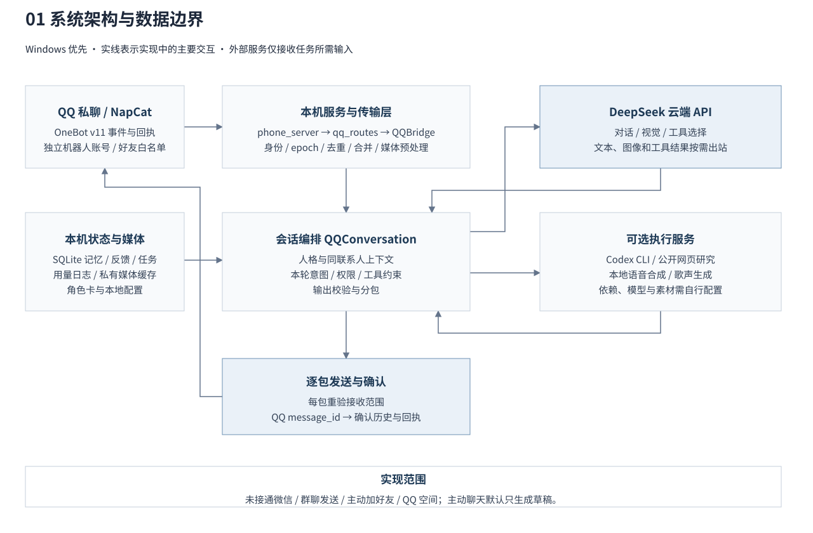
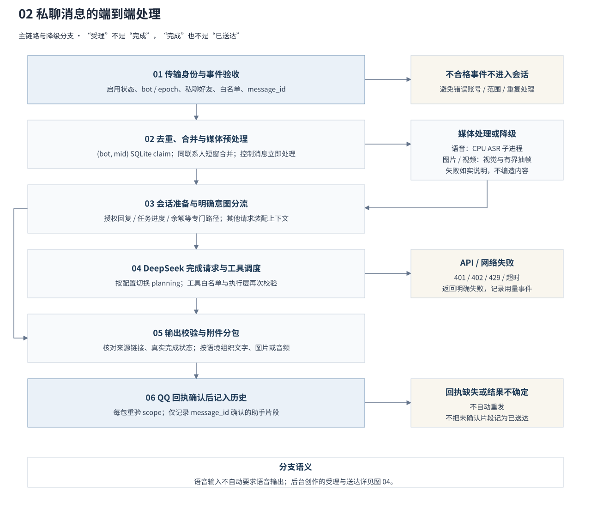
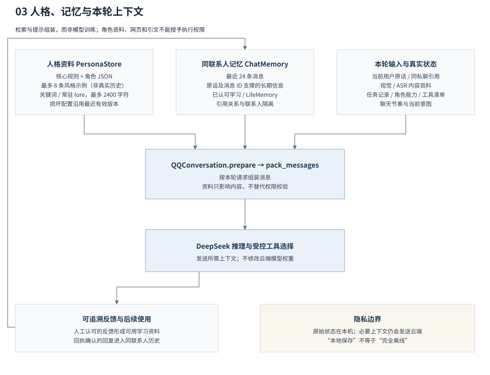
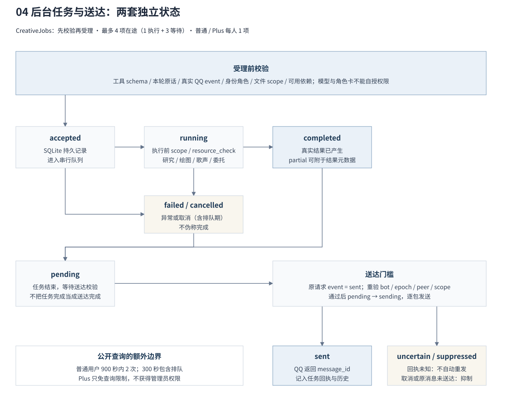

<div align="center">

# Whale Companion · 鲸娅

**让 QQ 里的 AI 能记事、接梗和使用工具，同时把权限、用量和本机资源管住。**

[English](README.en.md) · [快速开始](#快速开始) · [实现原理](docs/ARCHITECTURE.md) · [构建过程](docs/BUILD_LOG.md) · [素材与依赖来源](ATTRIBUTIONS.md)


</div>

Whale Companion 是一个 Windows 优先的本地 QQ AI 伙伴原型。DeepSeek 负责对话和工具选择；SQLite 保存按联系人隔离的记忆、反馈与任务状态；可选的 Codex Luna、语音和歌声模型负责公开资料整理、绘图及声音生成。

这个仓库公开应用源码、设计决策和配置模板，**不包含个人实例、账号登录状态、聊天记录、API Key、角色权重或下载的表情图片**。它不训练或修改云端 DeepSeek 的权重，也不保证接入 QQ 的所有客户端功能。

## 能做什么

| 能力 | 实现与状态 |
|---|---|
| QQ 私聊 | NapCat / OneBot v11，独立机器人账号、好友白名单、消息去重与连续来信合并 |
| 记忆与人格 | 最近对话、用户原话与消息编号支持的长期信息、独立任务状态、人工反馈；不同联系人隔离 |
| 图片与表情 | 图片/GIF 抽帧理解、按聊天语境选本地反应图；文字与表情多数分开发送 |
| 视频 | 有界抽帧 + 云端视觉，可选 CPU 对白识别；不声称完整逐帧看过视频 |
| 语音与清唱 | QQ 语音输入由本地 CPU 识别；原文朗读、可选乐谱驱动演唱与换声，检查唱词和完整性 |
| 一键登录与换号 | 优先恢复设备会话，按需用加密保存的密码重登；支持滑块、新设备确认和受控换号 |
| 公开资料查询 | 受控网页读取 + Codex Luna 整理、真实来源链接、超时保留已有结果 |
| 权限与用量 | QQ 号作身份主键，管理员/普通/手动 Plus；普通查询滚动 15 分钟 2 次、单次 5 分钟 |
| 用量与收支日志 | 任务状态、模型 Token、余额快照及净变化；未知费用不当成免费 |
| 一键启动 | Clash → Google HTTPS 检查 → ChatGPT → 本地服务；运行中的程序跳过 |

**尚未接入：** 微信、群聊的实际发送、主动加好友、空间浏览与发说说。连接器可能提供其中部分接口，接口存在不等于本项目已经开放或验证。主动聊天默认只准备草稿，需主人发送。

## 系统流程图

下面四幅图从组件边界、一次对话、人格记忆和后台任务四个层次解释当前实现。采用统一的白底灰蓝矢量排版，可放大阅读，并附可编辑 draw.io 源文件。**这是基于源码的实现说明，不是论文实验结果、安全形式化证明或真实 QQ 全链路验收报告。**

本节核对基线：[d7c61fc](https://github.com/LONG10222/whale-companion/tree/d7c61fc04043241c654e28210964abf69ef11916)。后续代码修改应同步图稿；本次文档不改变业务行为。

### 1. 系统架构：本机控制，按需调用外部服务



**图 1.** 实际主入口是 `phone_server.py` 注册的 QQ 路由和 `QQBridge`，而不是独立本地测试入口。传输层核对机器人身份与消息范围，`QQConversation` 组装上下文、约束工具调用；SQLite 和私有缓存保留本机状态。箭头表示主要交互方向，不表示这些组件拥有同等信任等级。

云端 DeepSeek、可选 Codex 与公开网页访问不属于离线计算。原始记录保存在本机，但调用云端时仍会传出任务所需输入。ASR 位于入站媒体预处理阶段；语音合成与歌声生成是独立可选输出能力。参见 [隐私说明](PRIVACY.md)。

[编辑图 1（draw.io）](docs/figures/01-system.drawio) · 代码：[入口](phone_server.py)、[路由](qq_routes.py)、[桥接](qq_bridge.py)、[会话](qq_chat.py)

### 2. 消息处理：接收、推理和送达不是同一件事



**图 2.** 入站事件必须通过身份、会话类型与白名单检查；消息按 `(bot, message_id)` 去重，再按联系人短窗合并。语音通过有界 CPU 识别，图片和视频走视觉资料处理；媒体失败只返回真实降级信息。会话准备中的授权回复、任务进度、余额查询和原文朗读等路径可直接处理，**并非所有输入都必须调用 DeepSeek**。

普通对话进入模型请求与受控工具调度，输出再经过来源、任务状态与附件分包检查。QQ 回传 `message_id` 才能确认送达；部分发送只记已确认片段，未知结果不自动重发。语音输入本身不要求语音输出。

**当前审查限制：** 图示表达已实现的回执流程，不证明所有并发条件都安全。审查发现发送期间切换机器人账号时，回执映射可能读取变化后的账号；“绑定发送时账号”的修复正在独立变更中处理，尚未包含于本节的源码基线。

[编辑图 2（draw.io）](docs/figures/02-turn.drawio) · 代码：[去重与合并](qq_batch.py)、[媒体与发送](qq_bridge.py)、[API 客户端](deepseek_client.py)、[输出分包](qq_delivery.py)

### 3. 人格与记忆：让上下文有来源，而不是伪造经历



**图 3.** 角色卡提供名字、语气与虚构背景；风格示例不是当前联系人的真实历史。最近对话、长期信息的原话证据、已认可学习、引用关系和任务状态分别参与组装。旧助手的能力自述不应取代当前真实任务记录；资料与授权必须分开。

反馈和已确认送达的历史供后续请求使用，但不会训练或修改 DeepSeek 权重。图中的闭环表示应用层状态更新，不表示模型自我训练。人格配置异常时沿用最近有效版本；不同联系人的上下文隔离。

[编辑图 3（draw.io）](docs/figures/03-context.drawio) · 代码：[角色卡](persona_store.py)、[记忆与装配](qq_chat.py)、[上下文规则](dialogue_context.py)

### 4. 后台工具：任务状态与送达状态分开管理



**图 4.** 执行层核对工具 schema、用户本轮原话、QQ 传输上下文、角色和文件访问范围，再将任务记录为 `accepted`。全局最多四项在途，实际串行执行；普通与 Plus 用户每人同一时间一项。模型输出工具名称或角色卡要求执行，不等于已经取得权限。

`completed` 只表示任务产生了真实结果，不能代替 QQ 送达确认。`partial` 是结果元数据或用量日志语义，不是图中的独立任务主状态；重启恢复还可能将遗留任务标记为 `interrupted`。取消结果会抑制发送，原请求没有 `sent` 回执也会抑制后台结果。送达结果不确定时不自动重发。

普通公开查询限制为滚动 900 秒内两次、单次 300 秒（含排队）；Plus 只免除这两项查询限制，不提升到管理员。管理员明确要求的双模型绘图对比也按顺序执行，不同时启动两项生成。

[编辑图 4（draw.io）](docs/figures/04-tools.drawio) · 代码：[任务状态与回执](qq_creative.py)、[Codex 执行边界](codex_workbench.py)

### 能力边界与阅读方式

- **已实现的应用路径：** 白名单 QQ 私聊、按联系人记忆、角色资料、工具校验、任务记录及回执追踪；实际运行仍依赖正确的本机配置和账号环境。
- **需要另行配置：** DeepSeek 凭据、NapCat 客户端，以及按需启用的 Codex、ASR、语音模型、歌声与素材；仓库不分发个人实例或模型权重。
- **本项目尚未接入：** QQ 空间发布或浏览、主动加好友、处理好友申请、群聊发送与微信。上游接口存在不等于本项目已实现或实测。
- **连接器的版本相关扩展：** NapCat 上游已有 `send_qzone_msg` 扩展（[PR #1965](https://github.com/NapNeko/NapCatQQ/pull/1965)），但这里没有调用链；`set_friend_add_request` 表示处理收到的好友申请，并不等于主动加好友。是否可用于特定客户端仍需独立兼容性核验，不能从图中推断支持。

图源与导出维护说明见 [图稿说明](docs/figures/README.md)。图稿以可观察代码行为为准，不把未完成能力、自动检查或模型预测包装成真实运行结果。

## 快速开始

### 1. 准备环境

- Windows 10/11、Python 3.12；QQ 使用单独的测试账号。
- 按 [NapCat 官方文档](https://napneko.github.io/) 安装与配置独立客户端。
- DeepSeek API Key 由自己在官方平台申请，费用由自己的账号承担。
- 本地大模型、CUDA、Codex 与 Clash 都是按功能需要配置的外部依赖，不随源码分发。

```powershell
git clone https://github.com/LONG10222/whale-companion.git
cd whale-companion
py -3.12 -m venv .venv
.\.venv\Scripts\python.exe -m pip install -r requirements.txt
.\.venv\Scripts\python.exe scripts/configure.py
```

配置程序交互填写管理员和机器人 QQ 号，随机生成本机访问凭据，密钥输入不会回显。生成的 `*.local.json` 被 Git 忽略；重复运行不会覆盖已有个人配置。**默认暂停回复、关闭群聊和语音。**

### 2. 接入自己的 QQ

1. 将 `configs/qq-client.example.json` 复制为 `configs/qq-client.local.json`，填自己的独立 NapCat 安装目录和启动程序。
2. 在 NapCat 配置本机 WebSocket 服务 `127.0.0.1:3001`，访问凭据与 `qq.local.json` 的 `onebot_token` 一致。WebUI 使用本机 `127.0.0.1:6099`。
3. 启动本地控制页，按页面提示扫码并在手机确认；先只允许管理员测试账号。

```powershell
.\.venv\Scripts\python.exe -m uvicorn phone_server:app --host 127.0.0.1 --port 18766 --no-access-log
```

打开 <http://127.0.0.1:18766/qq>。浏览器通过受限的本机同源会话自动连接，**不用手填本机令牌**。二维码按状态更新；已扫码、初始化或重连期间保持当前流程。手机确认与安全验证由本人完成。

也可以在「一键登录机器人小号」填写账号与密码。勾选保存后，凭据使用当前 Windows 用户的 DPAPI 加密；启动时先尝试设备快速登录，再按需用密码恢复。验证被拒绝后停止自动重试。选择已保存的小号或填写新小号即可进入换号流程，期间暂停回复、保留记忆，并核对新号及管理员好友关系。具体步骤见 [QQ 一键登录](docs/QQ_LOGIN.md)。

### 3. 桌面一键启动

确认上面的单独启动已可用，再编辑生成的 `configs/launcher.local.json`，核对 Clash 和 ChatGPT 应用位置。默认检查 Google `generate_204` 的 HTTPS 204 响应；不能联网就停止后续启动，不修改你的代理节点、订阅或系统设置。

```powershell
powershell -NoProfile -ExecutionPolicy Bypass -File scripts/install-shortcut.ps1
```

桌面快捷方式执行 `launch-whale.ps1`。它复用已有进程，检查服务是否属于本项目；发现端口被其他程序占用会停止。`-ExecutionPolicy Bypass` 只用于这一进程运行本地脚本，不更改系统执行策略。

```powershell
# 仅检查，不启动任何缺失的应用
powershell -NoProfile -ExecutionPolicy Bypass -File launch-whale.ps1 -CheckOnly -NoGui
```

## 可选模块

- **Codex：** 使用本机已登录的官方 Codex CLI；将 `configs/qq-workbench.example.json` 复制为本机配置，填已有项目的真实 ID 和目录。每个任务只可写自己的工作目录，其他资料需要当前明确只读授权。普通用户/Plus 仅 Luna，管理员上限 6.1 Sol/high；全部普通速度。
- **语音、清唱与换声：** 需要自行获取上游依赖、权重、合法可用的参考音频及配置。见 [模型与素材](ATTRIBUTIONS.md) 和 [安装说明](docs/SETUP.md)。没有这些文件时，声音功能会不可用，代码不会伪造生成成功。
- **QQ 语音输入：** 安装 `requirements-qq-voice.txt`，将 `configs/qq-voice.example.json` 复制为本地配置，填写 SenseVoice int8 模型与 Python 路径。接收识别不占常驻显存；语音输入本身不强制语音回复。
- **本地表情：** 仓库只带空索引。来源登记见 [asset-sources.csv](docs/asset-sources.csv)，按来源条款自行获取并使用 `scripts/import_stickers.py` 导入，在本机表情页查看。不要把私聊图片导入公开素材目录。
- **手机阅读：** 独立安卓模拟器 + ADB/UIAutomator，只读适配需按自身环境配置。见 [实现原理](docs/ARCHITECTURE.md)。

## 权限、超时与隐私

普通用户的一个问题计一次查询，内部读取多个网页不重复扣次数；额度按 QQ 号跨会话累计，重启不清零。5 分钟包括排队时间，超时结束所属查询进程树。有已读来源时返回摘要/来源摘录并保留未核实范围；没有可靠资料就自然说明，不编造、不假装继续后台工作。Plus 只能由本地管理页手动设置，免除这两项查询限制，**不会获得管理员或电脑访问权限**。

耗时任务全局串行，最多再等待三项；普通/Plus 每人同一时间一项。群聊尚未启用，不能把这些队列规则当作已经完成群聊接入的证明。

原始聊天、记忆、媒体缓存和收支日志保存在本机。调用云端模型时，本轮所需的文本、图片或工具结果会发送到相应服务商；“本地保存”不等于“全部离线”。详见 [PRIVACY.md](PRIVACY.md)。

近期改动包括：引用消息优先确定本轮主题、旧的助手能力自述不再当成当前事实、从实际任务记录回答型号与进度、按图中文字选择反应图，以及只记录取得 QQ 回执的消息片段。管理员明确要求时，同一项绘图任务可串行生成两个不同调度模型的对比版本；普通用户仍限 Luna。底层绘图模型未被回执披露时不会猜型号。详细原理与取舍见 [实现原理](docs/ARCHITECTURE.md) 和 [构建过程](docs/BUILD_LOG.md)。

## 测试与贡献

```powershell
.\.venv\Scripts\python.exe -m unittest discover -s tests -q
.\.venv\Scripts\python.exe scripts/scan_public.py
```

测试覆盖消息来源与去重、权限、记忆隔离、额度、进程终止、日志、同源自动连接和二维码状态。自动检查能发现错误，不能证明“像真人”、音色好听或所有 QQ 版本兼容。发布前请验证可选依赖和本机服务。

欢迎提交可复现问题、匿名测试用例和小范围 PR。报告问题前删除 QQ 号、Key、Cookie、代理订阅、聊天文本和本机绝对路径。参见 [CONTRIBUTING.md](CONTRIBUTING.md) 与 [SECURITY.md](SECURITY.md)。

## 致谢与许可

应用代码采用 [GPL-3.0](LICENSE)。第三方程序、模型、角色、音频、表情和品牌属于各自权利人，并不自动适用本项目许可证。完整来源、所用角色参考和未分发资产说明见 [ATTRIBUTIONS.md](ATTRIBUTIONS.md)。项目与 DeepSeek、OpenAI、腾讯或《鸣潮》官方无隶属或背书关系。

表情导入示例（目录应只包含你有权使用的公开图片）：

```powershell
.\.venv\Scripts\python.exe scripts/import_stickers.py C:/PublicStickers --source wuwa_user_download --pack "My permitted collection" --theme 鸣潮
```

默认不自动发送未标注图片；确认情绪标签后可使用 `--emotion` 显式标注。

