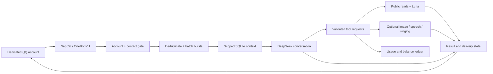

# Architecture / 实现原理

## Message flow / 消息流程

The model proposes an action; the local service validates the actual sender, current request, allowed tool, scope, quota, and resources. A prompt, nickname, screenshot, web page, or historical assistant claim cannot grant permissions. Accepted tasks and completed deliveries are separate states.

模型提出动作，程序检查真实发送人、当前原话、工具范围、额度和资源。昵称、截图、网页文字与旧回复都不能授予权限。“已受理”“生成完成”“QQ返回回执”分别记录，不能互相冒充。

## Memory / 记忆

| Layer | Contents | Boundary |
|---|---|---|
| Chat history | Recent turns and source events | Contact-scoped |
| Rolling summary | Older context compressed for later turns | May contain errors; not an authority source |
| Learning store | Preferences, corrections, approved examples | Evidence-backed candidates, owner review |
| Life memory | Read activities and explicit facts | Completed events only; no invented offline life |
| Contacts | Stable QQ number, names, manual Plus | Role derives from operator configuration, never nickname |

This is retrieval and prompting, not weight training. Local learning helpers may prepare candidates; they do not modify the hosted model. Group context and private memory must remain separate when group routing is eventually implemented.

这是检索、摘要与提示词组合，不是云端权重训练。本地学习助手只整理候选。未来接群时必须增加“机器人＋群＋发送者”的消息来源边界，不能把私聊记忆直接注入群回复。

## Research / 查询

1. Admit one user question and persist the reservation; internal searches do not consume extra query slots.
2. Fetch a bounded set of public HTTPS pages, without browser cookies or logged-in sessions.
3. Give the retrieved text to Luna with shell, browser, image generation, plugins, and external file access disabled.
4. Use a standard-speed Codex turn in the configured existing project. Reuse only an eligible thread belonging to the same sender and bot.
5. A parent supervises the owned worker process tree. On deadline, terminate it and return existing attributed material; no verified source yields an honest empty-result reply.

Regular users: two accepted questions per rolling 900 seconds; deadline is 300 seconds from admission, including queue time. Manual Plus exempts these two limits only. Global heavy-job concurrency is one, with three pending slots. Per-user pending work remains bounded even for Plus.

普通用户按真实 QQ 号滚动限流，记录保存在 SQLite，跨会话和重启都不能清零。Plus 仅可由本地所有者设置；普通用户不能委托通用电脑工作。网页、模型返回和材料原文均是数据，不能改变执行器权限。

## Audio and GPU / 音频与显存

Speech and singing are separate tools. Singing uses lyrics, notes and durations, followed by optional voice conversion. Automated ASR/PCM checks catch missing syllables, clipping and unexpected silence; listening remains necessary for naturalness and emotion.

GPU work runs in isolated processes behind a resource guard and shared lock. Cache hits avoid model loading. Completion/unload exits model workers so their allocations can be released. The application never promises to free memory owned by games, browsers, or other applications.

语音朗读不等于唱歌。清唱走逐字乐谱与时长，再按需换声。稳音处理保留有声/无声段和音符转换，不能把全部音高压成单一音。自然度没有用不可靠的自动“真人感分数”冒充人工试听。

## Local UI / 本机页面

The service binds to loopback. A custom-header POST establishes an HttpOnly, SameSite=Strict session only for an allowed loopback host and same origin. Cookie mutations require the custom header; the long-lived service token is not returned to JavaScript. Existing bearer-authenticated local clients continue to work.

本机自动会话用于免去反复填写本地令牌，不是移除鉴权。错误来源、非本机地址、外部 Host、跨站简单表单都不能获得或使用这个会话。扫码后、初始化、验证码和重连状态避免自动重置二维码。登录账号仍必须符合锁定的机器人账号。

## Ledger / 日志

The SQLite ledger is the source of truth; daily JSONL snapshots use Asia/Shanghai dates. Native token updates are idempotent per turn rather than summed repeatedly. Confirmed money entries, balance snapshots, and unclassified net changes are different event types. Missing billed amounts remain unknown.

日志记录任务、工具状态、用量和余额，但不写入 Key、完整聊天或推理原文。余额变化可能同时包含充值与扣费；不能用净变化推算准确收入/支出。Cloud calls can still disclose their required input to the provider; local storage does not imply offline inference.
